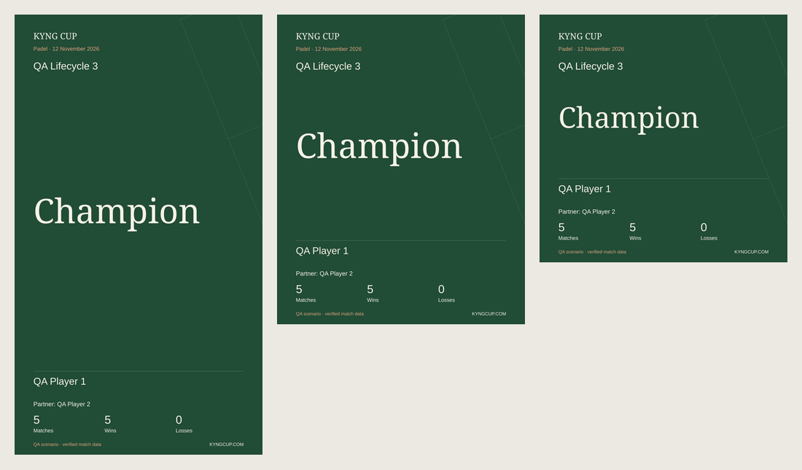

# KYNG CUP — расширенная проверка 18 ноября 2026

## Результат и границы проверки

Пройдены 256 автоматических проверок, сборка и статический экспорт. Созданы
16 синтетических профилей игроков, 19 заявок и три полностью сыгранных турнира
с 27 матчами в отдельном PostgreSQL/PGlite. Проверяются настоящие функции базы,
RLS, коды привязки, расчёты приложения и компоненты React.

**Это не полный браузерный прогон регистрации на рабочем сайте.** Схема,
функции, ограничения, индексы, права и политики взяты из рабочей базы 18 ноября;
данные реальных игроков не копировались. В изолированной базе моделируется
подтверждённый пользователь Auth, но не работа сервиса регистрации, SMTP или
выдача настоящего JWT. Тестовый организатор существует только в этой базе.

На рабочем сайте проверены публичные страницы и анонимные HTTP-запросы.
Этот прогон не создавал и не изменял рабочие аккаунты, турниры и результаты.
Открытого сеанса организатора в доступном браузере нет. Уже существующие в
рабочей базе три турнира `kyng-qa-global-20261118-ab1a2a13-*` были там до этой
проверки; они не являются результатом описанных ниже сценариев и не изменялись.

## Полные сценарии на копии схемы

| Сценарий | Пары / игроки | Матчи | Проверено |
| --- | --- | --- | --- |
| QA Lifecycle 1 — плей-офф | 4 / 8 | 3 | Черновик, публикация, заявки, полуфиналы, финал, исправление чемпиона |
| QA Lifecycle 2 — предварительные игры | 7 / 14 | 6 | Реальные предварительные игры, продвижение победителей, отсутствие технических побед в личной статистике |
| QA Lifecycle 3 — группы и две сетки | 8 / 16 | 18 | Две группы по четыре пары: 12 матчей, основной плей-офф: 3, утешительный: 3 |

Одни и те же аккаунты участвуют повторно: это проверяет объединение истории
и достижение «Сыгранная пара» после трёх турниров. Двум разным аккаунтам задано
одинаковое имя, чтобы имя не становилось ключом идентичности.

Для каждой пары основной игрок отправляет заявку под ролью `authenticated`.
Организатор подтверждает заявку и связывает её с парой. Второй игрок получает
одноразовый код и привязывает участие к собственному аккаунту. Проверены
ошибочный email, посторонний аккаунт, повторное использование, перевыпуск и
истечение кода. Приватные примечания организатора и контактные данные не
попадают в историю игрока.

Результаты сохранены через настоящие RPC. Отдельный журнал ожидаемых матчей
используется для проверки каждого из 16 игроков: число игр, побед, поражений,
партнёр, турниры, отсутствие дублей и содержание карточек. Утешительный
чемпион не получает основной титул. При сбросе финала карточка завершённого
турнира исчезает; после исправления чемпионом становится правильная пара.

Дополнительно проверены:

- запрет неверного победителя и изменения предыдущего победителя после
  завершённого следующего матча;
- независимость завершения основной и утешительной сеток;
- скрытие черновиков, недоступность чужих профилей и заявок;
- запрет создания турнира обычным игроком;
- загрузка и чтение аватара только владельцем, запрет чужого пути;
- сохранение профиля с защитой от устаревшей версии со второго устройства;
- дубликат заявки, закрытый и завершённый турнир, лист ожидания;
- существующие SQL-наборы создания турниров, результатов и истории, включая
  оба вида спорта, размеры до 64 пар, разные группы и права доступа.

## Найдено и исправлено в интерфейсе

1. **Нельзя было привязать второго игрока из обычной заявки.** Форма не имела
   поля email партнёра и всегда отправляла `player_two_email: null`, хотя выдача
   кода требует адрес партнёра. Добавлен необязательный email с пояснением на
   UA / EN / DE. Адрес нормализуется; одинаковые адреса двух игроков отклоняются.
   Заявка без email партнёра по-прежнему разрешена. Привязка остаётся через код
   организатора, автоматического присвоения участия по email нет.
2. **Закрытие регистрации во время заполнения давало общую ошибку.** Оба
   ответа базы — `Tournament registration is unavailable` и
   `Tournament registration is closed` — теперь показывают понятное сообщение
   о недоступной регистрации и сохраняют поля для повторной попытки.
3. Поле телефона допускало 100 символов, база — 40. Ограничения формы и базы
   приведены в соответствие.

Регрессионные тесты монтируют настоящую форму и проверяют переданный запрос,
необязательность email, одинаковые адреса, ошибки сервера и переводы. До правки
тест отправки партнёрского email падал из-за отсутствующего поля.

Старый SQL-набор истории создавал несколько заявок с одинаковыми контактами,
что несовместимо с действующим уникальным индексом. Контакты его независимых
фикстур разделены; уникальный индекс и правила базы сохранены.

## Карточки

На данных третьего сценария созданы и визуально просмотрены реальные PNG:
1080×1920, 1080×1350 и 1080×1080. На карточке основной пары — пять сыгранных
матчей, пять побед и ноль поражений. Расчёты проверены для всех игроков,
включая победителя утешительной сетки.



PNG здесь растеризованы через Sharp из настоящего SVG-генератора. Это не
доказательство скачивания браузером или открытия меню «Поделиться» на телефоне.
Обработчики загрузки, ошибок экспорта и системного обмена покрыты существующими
тестами компонентов с подменой браузерных API.

## Проверено непосредственно на рабочем сервисе

| Запрос / страница | Наблюдение |
| --- | --- |
| `/`, `/register/`, `/profile/` в браузере | Страницы открываются, форма доступна, кабинет требует входа |
| Auth settings по публичному ключу | Регистрация по email и Google включены; подтверждение email требуется |
| Чтение черновиков гостем | HTTP 200, пустой список |
| Чтение профилей гостем | HTTP 401, SQLSTATE 42501 |
| Чтение заявок гостем | HTTP 401, SQLSTATE 42501 |
| История матчей гостем | HTTP 401, SQLSTATE 42501 |

Факт включения Google в настройках не подтверждает успешный OAuth-вход.

## Оставшиеся проблемы в рабочих данных и обслуживании

| Приоритет | Находка | Действие |
| --- | --- | --- |
| Высокий | В `padel-invitational-2026-09-27` у 3 из 7 сыгранных матчей победитель противоречит счёту | Сверить исходные протоколы; результаты автоматически не переписывались |
| Высокий | В `vienna` у 9 из 21 сыгранного группового матча победитель противоречит счёту | Сверить групповые протоколы и затем перепроверить таблицы и личную историю |
| Средний | Турнир 26 сентября всё ещё `published/open`, присутствует в форме заявки; главная показывает сентябрьскую дату | Актуализировать статус и анонсы после решения организатора |
| Технический | `npm audit`: 42 записи — 1 critical, 24 high, 16 moderate, 1 low, включая инструменты сборки | Отдельное обновление зависимостей с проверкой сборки; наличие advisory само по себе не доказывает уязвимость опубликованной статики |
| Технический | `tsc --noEmit`: 8 ошибок типов окружений Cloudflare/Deno | Разделить настройки проверки веб-приложения, worker и Edge Functions |

Supabase health advisor не вернул замечаний. Security/performance advisors
отмечают вызываемые SECURITY DEFINER RPC, отключённую проверку утёкших паролей,
четыре внешних ключа без покрывающих индексов и несколько прочих рекомендаций.
Проверенные RPC защищены собственными проверками ролей; один этот тип функции
не означает, что её может использовать посторонний. Настройки и права
рабочего проекта не менялись.

## Что ещё нужно для полного приёмочного теста

Новый аккаунт через настоящий Auth, получение и открытие писем подтверждения
и восстановления, вход организатора и двух игроков в опубликованном интерфейсе,
мобильная ширина, браузерное скачивание PNG и системное «Поделиться» на устройстве.
Для этого нужны доступ к тестовой почте и авторизованный браузер. Эти пункты
не помечены выполненными на основании локальных тестов.

## Воспроизведение

```sh
npm ci
npm test
npm run build:pages
npm run lint
npm run test:player-sql
```

Изолированный полный цикл без сборки:

```sh
node --experimental-strip-types --test tests/global-lifecycle.test.mjs tests/registration-ui.test.mjs
```

`tests/fixtures/lifecycle-schema.sql` — снимок схемы, не миграция и не скрипт
для рабочей базы. Включает production-определения публичных таблиц, функций,
триггеров, ограничений, индексов, ACL и RLS на дату проверки. Только инфраструктура
Auth и таблица Storage минимально моделируются локально; внешние уведомления
исключены. При следующих миграциях снимок нужно обновить.
